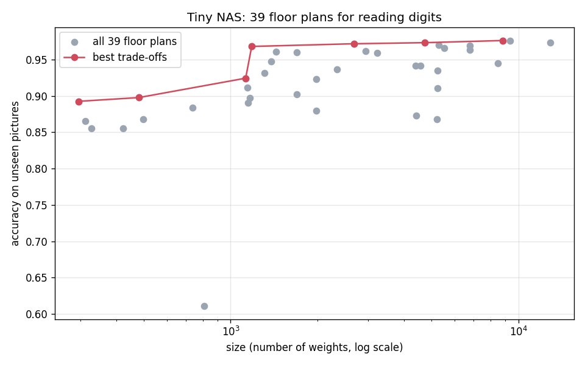

# tiny-nas

Neural Architecture Search, worked out with small examples. One idea per day.

I'm learning from MIT EfficientML Lecture 7 (Neural Architecture Search, Part I).
This repo is my notes in code form, written for someone new to the topic.

The idea in one line: instead of a person designing a neural network by hand,
let a computer search for a good design.

## Day 1: a real, tiny search, and the biggest model doesn't win

Pruning and quantization shrink a model someone already designed. NAS picks
the design itself.

```
quantization   →  same floor plan, cheaper bricks
pruning        →  same floor plan, remove some bricks
NAS            →  pick the floor plan: how many layers, how wide, what type
```

**Why a computer?** The choices multiply. With 6 layers and 9 options each,
there are 9⁶ = 531,441 designs. At 1 hour of training each, that's 60 years.

**Why not just training?** Training learns the weights *inside* a fixed
floor plan. It can't add a layer. So NAS is a loop around training:

```
NAS (outer loop):    pick a floor plan
   training (inner): learn its weights
   score it:         accuracy + size
   repeat
```

### The search

Task: read handwritten digits (0-9) from 8×8 grayscale pictures (1,797 of
them, built into scikit-learn). Each picture becomes 64 numbers.

```
64 pixels → [hidden layers] → 10 scores → pick the highest
                 ↑
     NAS chooses only this part: 1-3 layers, each 4, 16 or 64 wide
     3 + 9 + 27 = 39 floor plans
```

Each plan trains 3 times (to average out luck) and is scored on 450
pictures it never saw.



```
plan        weights   accuracy
4               296     89.3%
16            1,184     96.8%   ← the knee: small, nearly as good as the best
64-64         8,832     97.6%   ← best
64-64-64     12,928     97.3%   ← biggest, NOT the best
4-64-4          808     61.1%   ← worst
```

There's no single "best model". There's a best model **per budget**:
phone (≤ 1,000 weights) gets `4-16` at 89.8%, laptop (≤ 3,000) gets `16-64`
at 97.2%, no limit gets `64-64` at 97.6%.

Honest note: 0.3 points is about 1 picture out of 450. At the top, the big
plans are basically tied.

### Two stylized facts from our search

Patterns that held in our data, not laws:

1. **A pipe too narrow anywhere caps the whole model.** Every plan with a
   width-4 layer (best 94.7%) lost to every plan without one (worst 95.9%).
   Squeeze the picture into 4 numbers and the detail is gone. A wide layer
   after it can't bring it back. Once every layer is wide enough (16 vs 64),
   extra width barely helps.

2. **Deeper didn't help here.** Same width, 1 → 2 → 3 layers: flat or worse.
   This is task-specific. Deeper models do win on harder problems. That's why
   NAS exists: the rules change from task to task, so you search.

The model here is fully connected: it sees 64 numbers, not a picture, and
doesn't know which pixels are neighbors. Convolution builds that in. Layer
type is another choice NAS can make.

Try it: `python nas_tiny.py` (about 4 minutes). Tests: `python test_nas_tiny.py`.

## Day 2: the price tag of a layer, and a block that's 6× cheaper for free

Each layer type costs work. Smart blocks cut that work without losing accuracy.

Engineers track two price tags:

```
weights → storage   (how big is the file?)
MACs    → work      (multiply-adds per picture: speed, battery)
```

**Fully connected:** each weight is used once. 64 inputs × 16 outputs =
1,024 weights = 1,024 MACs.

**Convolution:** a small 3×3 "glass" slides over the picture and reuses the
same weights at every spot. One glass on an 8×8 picture: 9 weights, but
9 × 64 = 576 MACs. Small to store, busy to run.

A real one has 16 pages (channels) in and 16 glasses out:
3 × 3 × 16 × 16 × 64 spots = **147,456 MACs**.

### Three cheaper ways to build the same block

```
normal 3×3          every glass sees neighbors AND all 16 pages     147,456
depthwise + 1×1     A: each page alone sees neighbors                 9,216
                    B: each spot alone mixes all pages (1×1)        +16,384
                                                                   = 25,600  (5.8× less)
bottleneck          16 → squeeze to 4 → 3×3 → expand to 16           17,408  (8.5× less)
bottleneck + bypass same, but the original 16 pages skip around      17,408
                    and get added back. The block only learns the delta.
```

Groups in general: split the pages into G teams that don't talk, and the work
drops G×. Depthwise is the extreme, one page per team. The 1×1 step lets the
teams share clues again.

### The experiment

Same digits as Day 1. Only the middle block changes:

```
8×8 digit → [3×3, 1 → 16 pages] → [ MIDDLE BLOCK ] → average → 10 scores
```

5 trainings each, scored on 450 unseen digits:

```
block                 MACs      accuracy   (worst – best)
normal 3×3            147,456   95.2%      (92.9 – 97.1)
depthwise + 1×1        25,600   95.6%      (95.1 – 96.4)
bottleneck + bypass    17,408   91.6%      (89.1 – 94.0)
bottleneck             17,408   88.3%      (85.3 – 90.7)
```

My bet: normal > depthwise > bypass > bottleneck. Close: the top two are a tie.

1. **Depthwise + 1×1 matched the full block at one-sixth of the work.**
   "Where are the edges?" and "which clues go together?" can be learned in two
   separate, cheap steps. Google's MobileNet is built on this idea. On a big
   photo task it lost about 1 point for about 8× less work.
2. **The bypass rescued the squeeze.** Squeezing 16 pages to 4 hurt (like
   Day 1's width-4 layer). Adding the input back helped in all 5 trainings.
   That's the idea behind ResNet ("residual" = the delta).

Honest notes: digits are a tiny task, and our bottleneck squeezes 4×, like
ResNet's 2,048 → 512. Bigger tasks may show bigger gaps.

Try it: `python nas_blocks.py` (about 10 minutes). Tests: `python test_nas_blocks.py`.

## Day 3: what "blame" is, on a machine with one weight

Day 2's bypass helps training. To see why, we first need to know how training
decides which way to turn a weight. Today: one weight, by hand.

The machine: `output = input × weight`. Input 2, target 6, start weight 1.

```
loss  = (target − output)²          # squared, so overshooting is bad too
blame = how fast the loss changes when you nudge the weight
      = derivative of loss with respect to weight (the "gradient")
      = −2 × miss × input           # chain rule
```

At weight 1: miss = 4, so blame = −2 × 4 × 2 = **−16**.
The minus says "raise the weight". The 16 says "it's steep here".

Training moves **a small slice of the blame**, against it:

```
new weight = old weight − slice × blame
           = 1 − 0.05 × (−16) = 1.8

step   weight   miss    blame
  0    1.000    4.00   −16.00
  1    1.800    2.40    −9.60      steps shrink as we get close:
  2    2.280    1.44    −5.76      the loss is a bowl, steep far away,
 ...                               flat near the bottom
 12    2.996    0.01    −0.03
```

Use all the blame (slice 1) instead, and the weight jumps 1 → 17 → −95 → 689.
Blame gives the direction and steepness, not the distance.

Why not just solve `weight = target ÷ input` exactly? With one picture you can.
With many pictures they disagree (one wants 3.5, another 5), so there's no
exact answer. Small downhill steps still work. PyTorch's `loss.backward()`
computes this blame for every weight in a network.

Try it: `python blame.py` (instant). Tests: `python test_blame.py`.

A question for tomorrow: in a deep network, blame is many links multiplied
together. If each link is 0.5, how much blame reaches the first layer?

## Day 4: dividing bounces forever, small slices find a compromise

With one picture, you can fix the weight exactly: `weight = target ÷ input`.
With two pictures that disagree, that exact fix bounces forever. Small
gradient steps settle on a compromise instead.

Same machine as Day 3 (`output = input × weight`), now with two pictures:

```
A: input 2, target 6   → alone, A wants weight 3
B: input 1, target 5   → alone, B wants weight 5

Divide (jump to each picture's answer):   3, 5, 3, 5, 3, 5 ...  never settles
Slice 0.05 (small tug from each picture): 1.8, 2.1, 2.5 ... wobbles 3.26 ↔ 3.43
Batch (average both gradients, 1 step):   1.6 ... 3.400
```

My bet: the midpoint, 4. The answer: **3.4**. It leans toward A. Why?

```
loss = (6 − 2 × weight)²  +  (5 − 1 × weight)²
slope of A's part = −4 × missA     ← input 2 comes out of the chain rule
slope of B's part = −2 × missB     ← input 1

At 3.4:  missA = −0.8, missB = 1.6
         4 × 0.8 = 2 × 1.6   → the two tugs cancel
```

The weight has more grip on A's output (one unit of weight moves it by 2,
not 1). So training listens harder to the picture the weight can move.
Bigger inputs quietly get more say, which is one reason engineers scale
inputs to similar sizes before training.

The division rule also breaks on a tiny input: input 0.01 jumps the weight
from 1 to 600. The gradient multiplies by the input instead, so a tiny input
gets a tiny step. Averaging gradients over a batch (Day 2 used 32 pictures)
removes the wobble too.

Try it: `python divide_vs_slice.py` (instant). Tests: `python test_divide_vs_slice.py`.

Day 3's question (how much blame survives many links of 0.5?) is still open.
That's Day 5.

## Day 5: where "old − learning rate × blame" comes from

The update rule isn't a magic recipe. It comes from Taylor: the slope tells
you which way to go, and the learning rate stands in for the curve the slope
can't see.

Same machine (`output = input × weight`, input 2, target 6), standing at
weight 1: loss 16, slope −16. The slope gives a straight-line guess of the loss:

```
 step   line says   truth
  0.1     14.40     14.44    ✓ trust it nearby
   10   −144.00    256.00    ✗ impossible (a square is never negative)
```

A line has no bottom. It always says "go further," so it can't choose a step.
Add the bend (the second-order Taylor term) and you get a bowl with a bottom:

```
loss ≈ 16 − 16 × step + ½ × 8 × step²
              ▲                ▲
            slope          bend (how fast the slope changes)

bottom:  step = − slope ÷ bend = 16 ÷ 8 = 2   → weight 3, done in one step
```

That's Day 4's "divide" (miss ÷ input = 4 ÷ 2). It's called Newton's method.

Real networks can't afford the bend. With millions of weights it becomes a
millions × millions table. So gradient descent guesses it: **bend ≈ 1 ÷
learning rate**. The bottom of that guessed bowl is

```
step = − learning rate × slope        ← the update rule

rate 0.05  (guessed bend 20, too steep):  step 0.8 → weight 1.8   safe, slow
rate 1/8   (guessed bend 8, just right):  step 2   → weight 3     perfect
rate 1     (guessed bend 1, too flat):    step 16  → weight 17    blow-up
```

The trade-off: a small learning rate means a cautious, slow step. A big one
means trusting the straight line too far. PyTorch's `torch.optim.SGD(lr=...)`
uses exactly this rule; the `lr` is your guess for one over the bend.

Try it: `python where_the_step_comes_from.py` (instant).
Tests: `python test_where_the_step_comes_from.py`.

Day 3's question (how much blame survives many links of 0.5?) moves to Day 6.

## Day 6: blame fades (or explodes) through a long chain

The miss only exists at the end, so blame walks back from there. Each link
it crosses multiplies it by that link's weight. Many weights below 1 make it
fade. Many weights above 1 make it explode.

Why multiply by the weight? A link does `out = w × in`. Bump `in` by 1 and
`out` moves by `w`. So the error cares about `in` exactly `w` times as much
as it cares about `out`.

```
10 links of 0.5:   start 0.001 ← ... ← 0.25 ← 0.5 ← 1 end    (vanishing)
10 links of 2:     start 1024  ← ... ← 4    ← 2   ← 1 end    (exploding)
10 links of 1:     start 1     ← ... ← 1    ← 1   ← 1 end    (steady)
```

A layer with blame 0.001 takes a step 1,000× smaller, so it barely learns.
A layer with blame 1,024 takes a giant step, like Day 3's blow-up.

**Why walk backward at all?** You could bump each weight and rerun the chain
forward. You'd get the same blame, but you'd need a separate run for every
weight. A network has millions of weights and only one error, so one walk
back that drops off every weight's share wins:

```
links     forward hops    backward hops
  10            55              10
 100         5,050             100
```

The trade-off: the backward walk must remember every middle number from the
forward run. Backward saves compute and spends memory. That's why training
needs far more memory than inference. PyTorch's `loss.backward()` is this walk.
It's called backpropagation.

Day 3's question answered: through 10 links of 0.5, about 0.001 of the blame
survives. Through 50, less than one part in a million billion.

Try it: `python fading_chain.py` (instant). Tests: `python test_fading_chain.py`.

A question to think about: a link of 1 keeps blame steady. Day 2's bypass
adds the input back (`out = block(in) + in`). What does that `+ in` do to the
link?
